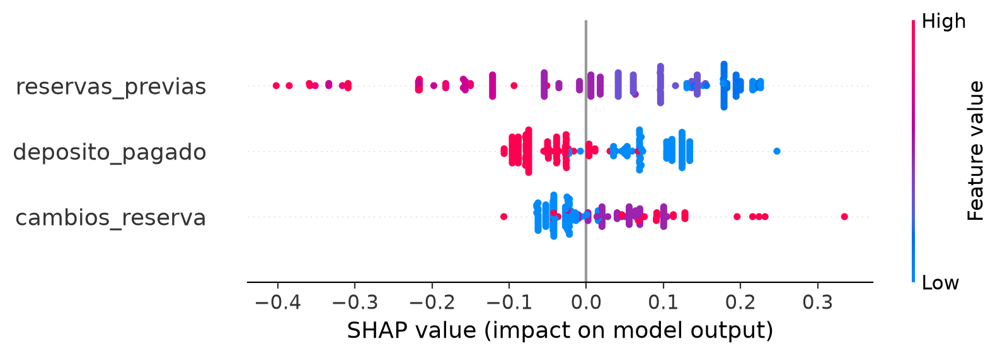
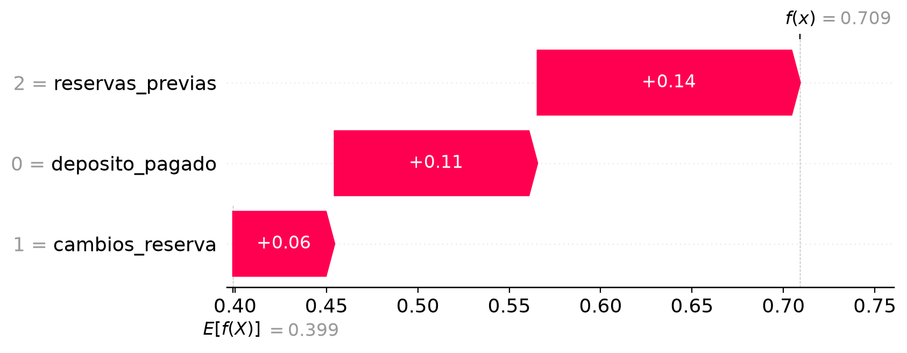

# Práctica XAI: reservas de hotel

Esta práctica analiza la predicción de no presentados a partir de datos de las reservas de un hotel. Se utilizan dos modelos, una regresión logística, interpretable mediante sus coeficientes, y un Random Forest, explicando usando SHAP. Ambos trabajan con las variables obtenidas usando Forward Feature Selection (FFS), un método de Feature Subset Selection (FSS).

## 1. Preparación de datos.

Nuestro conjunto tiene 6000 datos de reservas y 10 variables, descartadas el ID y variable objetivo. Hay un gran desbalace entre los datos (92% de presentados frente a un 8% de no presentados). Realizamos una partición de forma estratificada, dejando un 25% para test y 75% para train. Para fijar usamos la semilla 42.

## 2. FSS

Utilizamos FFS. Es un método wrapper, que parte de un subconjunto vacío y va añadiendo progresivamente la variable que más mejora, hasta cumplir el criterio de parada. Para ello usamos SequentialFeatureSelector, usando como dirección forward. El FFS selecionó 3 de las 10 variables, empleando una tolerancia de mejora de 0.0001. Las variables son: reservas_previas, cambios_reserva y deposito_pagado.

## 3. Modelos y umbral de decisión

Se utilizó una regresión logística, con StandardScaler, ponderación de clases y un máximo de 2000 iteraciones. Para Random Forest se usaron 200 árboles. Al ser más complejo y menos interpretable usamos SHAP para poder hacerlo.

En vez de usar un umbral de probabilida de 0.5, comparamos 0.3, 0.5 y 0.7 mediante CV sobre el train, calculando el coste como 70FN + 3FP. 

El umbral que minimizada el coste para ambos modelos era 0.3, priorizando así la detección de no presentaciones y aceptando más falsas alarmas. 

## 4. Resultados en test

| Métrica | Regresión logística | Random Forest |
| --- | ---: | ---: |
| Umbral | 0.3 | 0.3 |
| Accuracy | 0.3913 | 0.4960 |
| Precisión (clase 1) | 0.1070 | 0.1196 |
| Recall (clase 1) | **0.9000** | 0.8333 |
| F1 (clase 1) | 0.1913 | **0.2092** |
| ROC-AUC | **0.7278** | 0.7167 |
| Verdaderos negativos (TN) | 479 | 644 |
| Falsos positivos (FP) | 901 | 736 |
| Falsos negativos (FN) | 12 | 20 |
| Verdaderos positivos (TP) | 108 | 100 |
| Coste en test (`70·FN + 3·FP`) | **3.543** | 3.608 |

Vemos que ningún modelo destaca en todas las métricas. La regresión logra un coste ligeramente inferior, si se prioriza reducir falsas alarmas, el Random Forest es mejor. En ambos casos la precisión de la clase positiva es baja por lo que requiere de precaución. 

## 5 Interpretabilidad y SHAP 

En la regresión logística:

reservas_previas = -0.6974
cambios_reserva = 0.336
deposito_pagado = -0.3673

Vemos que más reservas previas se asocian con una menor probabilidad de no presentarse, y en menor medida ocurre lo mismo con deposito_pagar. Por otra parte, más cambios en la reserva se asocian con una mayor probabilida de no presentarse.

En el random forest:



Vemos que empleando SHAP para el RandomForest conseguimos ver las variables más importantes para la predicción, e igual que en la regresión, disponer de más reservar previas y haber pagado un depósito tiende a reducir la predicción de no presentarse mientras que un mayor número de cambios tiende a aumentarla-

Mirando de manera local:

Usamos la reserva con el índice 665, tiene 2 reservas previas, 1 cambio y no tiene deposito pagado.



Vemos para este caso que SHAP muestra una base de 0.399 aprox. y una probabilidad de 0.709, con contribuciones postivas de 0.14, 0.11 y 0.06 de las tres variables respectivamente. Con un umbral de 0.3, se considera no presentada, pero su etiqueta real es 0, por lo que es un FP. Esto nos ayuda a ver que SHAP únicamente explica la decisión, pero no demuestra que sea correcta. 

## 6. Reproducir el experimento.

Usando Python 3.12 y uv, desde la raíz:

```bash
uv sync

uv run python src/feature_selection.py

uv run python src/train.py

uv run python src/evaluate.py

uv run python src/explain.py
```

train.py ejecuta FFS antes de entrenar los dos modelos. Los modelos se guardan en el formato .pickle dentro de models/, y lo generado por SHAP dentro de reports/.

## 7. Estructura

```text
PracticaXAI/
├── data/
│   └── raw/
│       └── 01_reservas_hotel.csv
├── models/
│   ├── logistica.pickle
│   └── random_forest.pickle
├── reports/
│   ├── shap_global.png
│   └── shap_local.png
├── src/
│   ├── config.py             # Rutas y parámetros globales
│   ├── data.py               # Lectura y partición
│   ├── feature_selection.py  # FFS y CV
│   ├── train.py              # Modelos y umbral
│   ├── evaluate.py           # Evaluación test
│   └── explain.py            # Explicaciones SHAP
├── pyproject.toml
├── uv.lock
└── README.md
```
